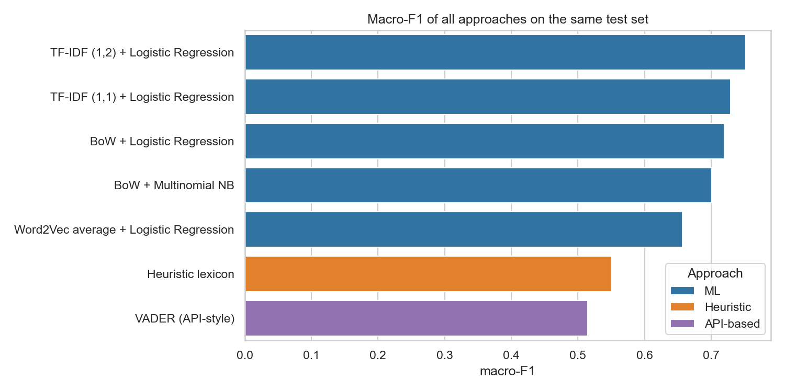
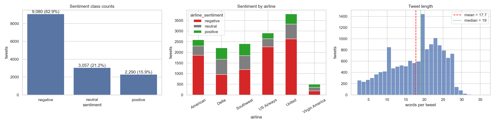
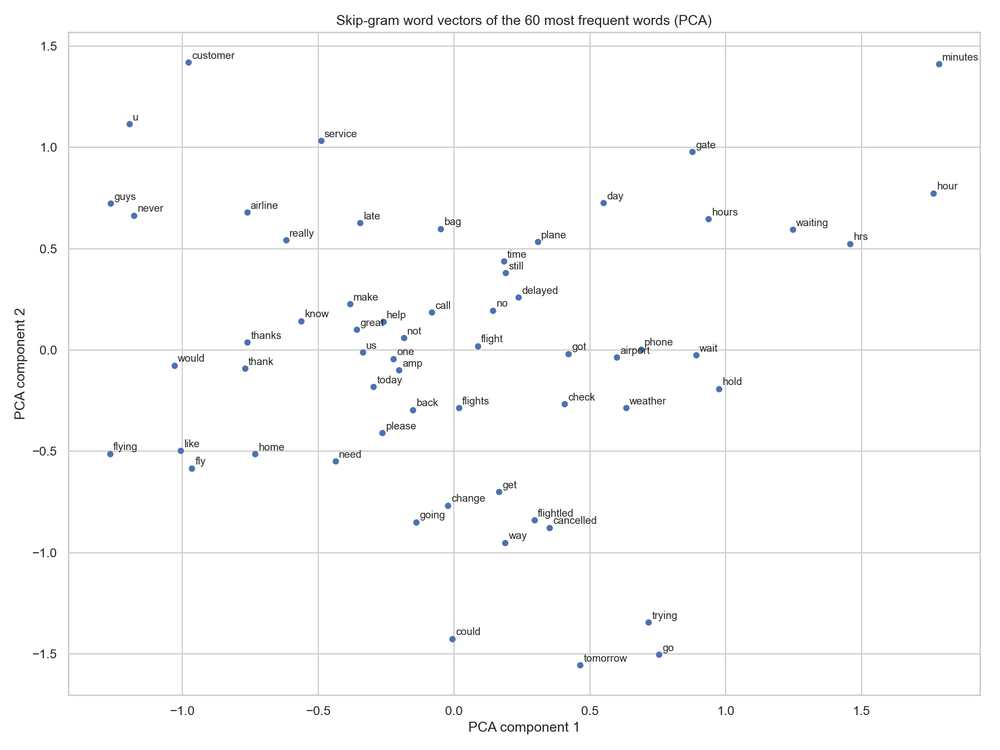

# ✈️ Live App: _paste your Streamlit Community Cloud URL here_

<div align="center">


</div>

---

## 📌 Overview
A 3-class sentiment classifier (**negative / neutral / positive**) for real, noisy airline tweets. The notebook walks through every stage of a basic NLP pipeline (RegEx cleaning, tokenisation, feature extraction, models, evaluation, POS tagging) and compares **three NLP approaches on the same test set**: a hand-made heuristic lexicon, the ready-made VADER tool and machine-learning models. The best pipeline is saved and served by a Streamlit app.

No deep learning, Transformers or large-language-model APIs are used: the project covers NLP fundamentals only.

## 📂 Dataset
| Field | Detail |
|---|---|
| Name | Twitter US Airline Sentiment |
| Source | [Kaggle: crowdflower/twitter-airline-sentiment](https://www.kaggle.com/datasets/crowdflower/twitter-airline-sentiment) (originally published by CrowdFlower / Figure Eight) |
| File | `Tweets.csv` (the SQLite file in the download is not needed) |
| Size | about 14,640 tweets, 15 columns; only `text`, `airline_sentiment` and `airline` are used |
| Class balance | roughly 63% negative, 21% neutral, 16% positive, so accuracy alone is misleading and **macro-F1** is the main metric |
| Issues handled | exact duplicate tweets, @mentions at the start of every tweet, URLs, hashtags, mixed case, slang, misspellings, emojis |

> `Tweets.csv` is not stored in this repository. Download it from the Kaggle link and place it next to the notebook (`PR1/Tweets.csv`).

## 🗂️ Repository Structure
```
NLP/
└── PR1/
    ├── NLP_PR1.ipynb          # Tasks 1-7 (fully executed notebook)
    ├── app.py                 # Streamlit app (Task 8)
    ├── nlp_utils.py           # clean_text, lexicon, heuristic and VADER helpers shared by notebook and app
    ├── model/
        ├── sentiment_model.joblib # saved best pipeline (vectoriser + classifier)
    ├── requirements.txt       # libraries the app needs, pinned versions
    ├── screenshots/           # app and analysis screenshots
    ├── dataset/               # data
    └── README.md
```

## 🔄 Pipeline
```
raw tweet → clean → tokenise → stop-word handling → features → classifier → evaluation → deployment
```
| Stage | What was done on the airline tweets |
|---|---|
| Clean | lowercase; remove URLs and @mentions; keep the hashtag word; expand "n't" to "not"; keep letters only; collapse spaces |
| Tokenise | `nltk.word_tokenize` |
| Stop words | NLTK list **minus** *no, not, nor, never*, so "not happy with the delay" keeps its meaning |
| Features | Bag-of-Words, TF-IDF, n-grams (1-3), averaged Word2Vec vectors |
| Models | Multinomial Naive Bayes and Logistic Regression (`class_weight='balanced'`) in scikit-learn Pipelines |
| Evaluation | stratified 80/20 split (`random_state=42`) before any vectoriser or Word2Vec fitting, macro-F1, per-class precision/recall, 5-fold CV on the training data |
| Deployment | Streamlit Community Cloud |


**Deployed pipeline:** … (highest macro-F1 among the pipelines that take text directly) · 5-fold CV macro-F1 = … ± … · test macro-F1 = …

## 🧠 Topics Explained

**RegEx cleaning and tokenisation.** Tweets are full of URLs, mentions, hashtags, numbers and slang. Each pattern (`https?://\S+`, `@\w+`, `#(\w+)`, `\d+`, `[^a-z\s]`, `\s+`) was tested on a small example and then combined in `clean_text()`. Punctuation and emojis can carry sentiment, so removing them is a known loss.

**Heuristic approach.** A 35-word positive and a 38-word negative lexicon, chosen for airline tweets (delay, cancelled, lost, rude, thanks, friendly...). The score is positive words minus negative words, and a word's polarity flips when one of the two previous words is a negation. It is transparent and needs no data, but it only knows the words listed.

**API-based approach.** NLTK VADER applied to the raw tweet (compound ≥ 0.05 positive, ≤ -0.05 negative). Cloud services such as Google Cloud Natural Language, AWS Comprehend and Azure Text Analytics work the same way (send text, receive a sentiment as JSON) but need an account, an API key and billing, so they are only described here.

**Bag-of-Words and TF-IDF.** BoW counts words and ignores order and meaning. TF-IDF multiplies the term frequency by `ln(N/df) + 1`, so words that appear everywhere get a low weight. Both were built by hand and with scikit-learn and matched; the default `TfidfVectorizer` differs by smoothing and L2 normalisation. Vectorisers are fitted on the training tweets only, to avoid leakage.

**N-grams.** Bigrams such as *customer service* or *not happy* carry meaning their single words do not. The cost is a much larger and sparser vocabulary; a feature-size experiment compares vocabulary size and memory for `ngram_range` and `max_features`.

**Word2Vec (CBoW and Skip-gram).** Both trained on the training tweets (100 dimensions, window 5, `min_count=3`, 20 epochs, `seed=42`, `workers=1`). CBoW predicts the centre word from its context, Skip-gram predicts the context from the centre word and copes better with rare words. The corpus is small, so the vectors are noisier than ones trained on huge corpora. Averaged vectors are used as document features.

**Text classification pipeline.** The vectoriser and classifier sit in one scikit-learn `Pipeline`, which prevents leakage in cross-validation and makes deployment a single saved object. `class_weight='balanced'` stops the model from favouring the 63% negative class.

**POS tagging.** NLTK's averaged-perceptron tagger (trained on news text, so tweets are harder). Used to compare the word-type mix per sentiment class and to build POS-filtered features (adjectives, adverbs, verbs and negations only).

## 🖥️ The App
Tweet Sentiment Analyzer (`app.py`):
- text box with **3 example buttons** (positive, negative, tricky) that fill the box
- **approach selector**: Heuristic / VADER / ML model
- Predict button with a **coloured result** (green positive, yellow neutral, red negative) and the cleaned text
- **probability bar chart** for the ML model
- collapsible **POS-tag table** of the tweet
- robust input handling: empty input shows a warning, input longer than 500 characters is truncated with a message, tweets that are empty after cleaning (emoji-only, URL-only) show a warning, and missing NLTK data is downloaded at start-up

## ▶️ Run Locally
```bash
git clone https://github.com/krish-desai-123/NLP.git
cd NLP/PR1
pip install -r requirements.txt jupyter "gensim>=4.4" matplotlib seaborn
jupyter notebook NLP_PR1.ipynb      # Kernel > Restart & Run All (creates sentiment_model.joblib)
streamlit run app.py
```
`requirements.txt` lists only what the app needs, with the versions used for training. The model was saved with **scikit-learn …** (the version printed in notebook cell 6.7); a different version may fail to load it, so use the same one.

## ☁️ Deploy on Streamlit Community Cloud
1. Push the folder to a **public** GitHub repository (include `sentiment_model.joblib`, not `Tweets.csv`).
2. On [share.streamlit.io](https://share.streamlit.io) sign in with GitHub and choose **New app**.
3. Select the repository and branch, and set the main file path to `PR1/app.py`.
4. Deploy, wait for the build, then test 3 predictions on the live URL and paste it at the top of this README.

## 📸 Screenshots
| | |
|---|---|
| <br/>**Start screen:** title, example buttons, approach selector | <br/>**Positive prediction** with the cleaned text |
| <br/>**Negative prediction** (red result) | <br/>**Class probabilities** of the ML model |
| <br/>**POS-tag expander** | <br/>**Macro-F1** of heuristic, VADER and ML approaches |
| <br/>**EDA:** class counts, sentiment by airline, tweet length | <br/>**Word2Vec:** PCA of the 60 most frequent words |


## ⚠️ Limitations and Next Steps
- Sarcasm, Hinglish or misspelled tweets and neutral tweets are often pushed towards *negative*; the model only sees words and a few bigrams.
- The lexicon and Word2Vec vectors are small (one data source, about 11,000 training tweets).
- Next steps: more labelled data, tuning `min_df` / `max_features` with cross-validation, trigram features, and a Transformer model (e.g. DistilBERT) for context, which is outside the scope of this practical.


