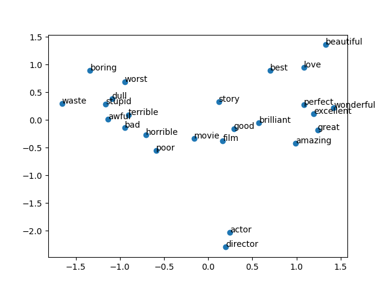
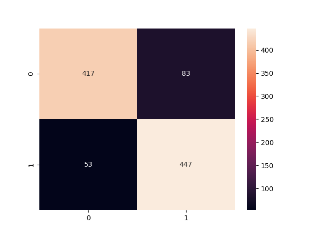
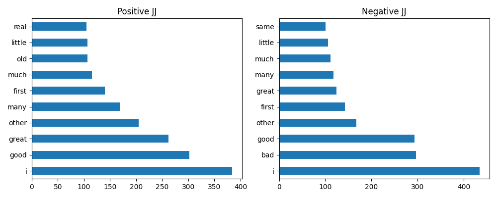

<div align="center">

# 🗣️ NLP Practical Exam — Set A
### OTT Review Analytics: From Raw Text to a Deployed Sentiment App

[](https://www.python.org/)
[](https://www.nltk.org/)
[](https://scikit-learn.org/)
[](https://radimrehurek.com/gensim/)
[](https://streamlit.io/)
[]()

*A full NLP pipeline for an OTT streaming platform — RegEx cleaning, Bag-of-Words/TF-IDF/N-Grams,
Word2Vec embeddings, four sentiment classifiers, a heuristic-vs-API-vs-ML comparison, POS tagging,
and a deployed Streamlit app — built one concept at a time on real SMS and IMDb review data.*

</div>

---

## 🧭 Table of Contents

- [📌 Overview](#-overview)
- [🗂️ Datasets](#️-datasets)
- [🗺️ Project Roadmap](#️-project-roadmap)
- [🧹 Step 1 — Text Preprocessing & RegEx](#-step-1--text-preprocessing--regex)
- [🔢 Step 2 — Bag-of-Words, TF-IDF & N-Grams](#-step-2--bag-of-words-tf-idf--n-grams)
- [🧬 Step 3 — Word2Vec Embeddings](#-step-3--word2vec-embeddings)
- [🎯 Step 4 — Sentiment Classification](#-step-4--sentiment-classification)
- [⚖️ Step 5 — Heuristic vs. VADER vs. ML, and POS Tagging](#️-step-5--heuristic-vs-vader-vs-ml-and-pos-tagging)
- [🌐 Step 6 — Streamlit App](#-step-6--streamlit-app)
- [📊 Results Leaderboard](#-results-leaderboard)
- [⚙️ Tech Stack](#️-tech-stack)
- [🚀 Getting Started](#-getting-started)
- [📁 Repository Structure](#-repository-structure)
- [🙋 Author](#-author)

---

## 📌 Overview

An OTT platform gets thousands of viewer reviews a day — too many to read by hand. This project
builds the full pipeline to automate it, one NLP layer at a time:

> `RegEx & Cleaning` → `BoW / TF-IDF / N-Grams` → `Word2Vec (CBOW & Skip-gram)` → `4 Classifiers` → `Heuristic vs. API vs. ML` → `POS Tagging` → `Streamlit Deployment`

Every stage is benchmarked against the next — hand-rolled rules against a pretrained lexicon
against a trained model — so the final app isn't just functional, it's backed by evidence for
*why* a learned TF-IDF + Logistic Regression pipeline is the right tool for this job.

---

## 🗂️ Datasets

| Dataset | Used for | Size | Included in repo? |
|---|---|---|:---:|
| **SMS Spam Collection** | RegEx & preprocessing fundamentals (Step 1–2) | 5,572 messages | ✅ `dataset/spam.csv` |
| **IMDb 50K Movie Reviews** (balanced 5,000-review sample) | Word2Vec, classification, POS tagging (Step 3–5) | 5,000 reviews (2,500 pos / 2,500 neg) | ❌ too large for this repo |

> 📦 **IMDb dataset not included** — it was too large to commit alongside the notebook. Download
> `IMDB Dataset.csv` from Kaggle — [IMDB Dataset of 50K Movie Reviews](https://www.kaggle.com/datasets/lakshmi25npathi/imdb-dataset-of-50k-movie-reviews)
> — and place it at `dataset/IMDB Dataset.csv` before running Steps 3 onward. The notebook
> samples 2,500 positive + 2,500 negative reviews from it with `random_state=42`, so the sample
> is reproducible once the file is in place.

---

## 🗺️ Project Roadmap

| Step | Topic | Dataset | Technique | Result |
|:---:|---|---|---|---|
| 1 | RegEx & Cleaning | SMS Spam (5,572) | `re`, NLTK tokenize/lemmatize | Cleaned text column |
| 2 | BoW & TF-IDF | Tiny demo corpus + SMS | `CountVectorizer`, `TfidfVectorizer` | 3,000-feature matrices |
| 3 | Word2Vec | IMDb (5,000) | CBOW & Skip-gram, PCA | 100-d embeddings |
| 4 | Classification | IMDb (5,000) | Logistic Regression ×4 | Best F1 ≈ 0.87 |
| 5 | Approaches & POS | IMDb test (1,000) | Heuristic, VADER, ML, POS tagging | ML beat both baselines |
| 6 | Streamlit | Saved pipeline | `app.py` | Working web app |

---

## 🧹 Step 1 — Text Preprocessing & RegEx

**Dataset:** SMS Spam Collection — 5,572 messages, 747 spam (**13.4%**), 4,825 ham.

<table>
<tr>
<td width="50%"><br><sub>Spam vs. ham class balance</sub></td>
<td width="50%"><br><sub>Message length by class</sub></td>
</tr>
</table>

**RegEx findings on raw text:**

| Pattern | Finding |
|---|---|
| URLs (`(?:http\|www)\S+`) | 105 spam vs. 2 ham messages contain one |
| Phone numbers (`\d{10,}`) | Found in classic spam ("Free entry... Text FA to 87121...") |
| Currency symbols (`£`/`$`) | **93.5%** of messages containing one are spam |
| `re.sub(r'\d+', 'NUM', ...)` | Numbers normalized to a `NUM` token for cleaner features |

**Cleaning pipeline:** lowercase → strip URLs → strip non-alphabetic characters → tokenize →
remove English stop words → lemmatize with `WordNetLemmatizer`.

**Stemming vs. lemmatization**, demonstrated on 8 words:

| Word | Stem (Porter) | Lemma (WordNet) |
|---|---|---|
| running | run | running |
| flies | fli | fly |
| better | better | better |
| studies | studi | study |
| wolves | wolv | wolf |

Stemming chops suffixes with fixed rules (fast, sometimes wrong — "studi" isn't a word);
lemmatization looks up the dictionary root (slower, always a real word).


*Top 15 words per class — `call`, `free`, `txt`, `claim`, `prize` dominate spam, exactly the
words you'd expect from promotional/fraud messages.*

---

## 🔢 Step 2 — Bag-of-Words, TF-IDF & N-Grams

Demonstrated first on a 4-sentence toy corpus (`"the movie was good"`, `"the movie was bad"`,
`"good acting and good story"`, `"not a good movie"`), then applied to the real SMS data.

- **Bag-of-Words:** raw word counts, no order, no context.
- **TF-IDF:** down-weights common words (`movie`, appears in 3/4 docs) and up-weights rare,
  informative ones (`acting`, appears in 1/4 docs).
- **N-Grams `(1,2)`:** the toy corpus shows *why* this matters — in `"not a good movie"`, the
  bigram `not good` captures the negation that unigrams alone would miss, misreading the review
  as positive.

**On the real SMS data** (3,000-feature matrices): top TF-IDF terms were `call`, `im`, `ok`,
`get`, `ill`; top bigrams were `gon na`, `please call`, `call later`. All three feature types
landed at **~99.75% sparsity** — expected for short, varied text against a fixed vocabulary.

---

## 🧬 Step 3 — Word2Vec Embeddings

**Dataset:** the 5,000-review balanced IMDb sample, averaging **117.9 tokens per cleaned review**.

Two 100-dimensional models trained with `gensim.Word2Vec` (window=5, min_count=5, 10 epochs,
`random_state=42`): **CBOW** (`sg=0`, predicts a word from its context) and **Skip-gram**
(`sg=1`, predicts context from a word) — each learning a 10,883-word vocabulary.

| Word | CBOW nearest neighbours | Skip-gram nearest neighbours |
|---|---|---|
| good | ok, bad, decent | balancing, goodi, assured |
| bad | horrible, awful, terrible | comeback, ugh, uh |
| actor | actress, cast, role | performer, ensemble, urmila |
| boring | dull, predictable, dumb | dull, excruciatingly, unimaginative |

CBOW's neighbours read as cleaner synonyms here — on this 5,000-review corpus, Skip-gram's
strength on *rare* words shows up more in its noisier, longer-tail associations than in these
common adjectives.



*2D PCA projection of 25 sentiment-charged words from the Skip-gram embedding space — positive
and negative vocabulary separate into visibly distinct regions.*

Skip-gram model saved to `model/word2vec_skipgram.model`.

---

## 🎯 Step 4 — Sentiment Classification

**Split:** 80/20 stratified on the 5,000-review IMDb sample → 4,000 train / 1,000 test.

Four Logistic Regression pipelines, same classifier, different feature representations:

| Model | Features | Accuracy | Precision | Recall | F1 |
|---|---|:---:|:---:|:---:|:---:|
| **TF-IDF** | `TfidfVectorizer`, 5,000 features | **0.868** | 0.852 | 0.890 | **0.871** |
| TF-IDF N-Grams | `(1,2)`, 10,000 features | 0.864 | 0.843 | 0.894 | 0.868 |
| Bag-of-Words | `CountVectorizer`, 5,000 features | 0.838 | 0.834 | 0.844 | 0.839 |
| Word2Vec (averaged) | Mean of 100-d Skip-gram vectors | 0.836 | 0.835 | 0.838 | 0.836 |


Plain **TF-IDF edges out N-Grams** on this split (0.871 vs. 0.868 F1) — close enough that either
is a reasonable pick, but the extra 10,000-feature N-gram vocabulary didn't pay for itself here.
Averaged Word2Vec trails both: collapsing a whole review into one mean vector dilutes the
individual sentiment-bearing words, especially on a corpus this size.



**Top learned coefficients** (TF-IDF N-Grams model): strongest positive — `great`, `excellent`,
`best`, `love`, `perfect`; strongest negative — `bad`, `worst`, `poor`, `waste`, `awful`. The
model's 5 sampled errors were reviews with mixed opinions or understated phrasing — exactly the
cases a bag-of-words-style model struggles with.

Best pipeline saved to `model/sentiment_pipeline.pkl`; spot-checked on 5 hand-written reviews,
all predicted correctly with 76–97% confidence.

---

## ⚖️ Step 5 — Heuristic vs. VADER vs. ML, and POS Tagging

Three sentiment approaches compared on the same 1,000-review held-out test set:

| Approach | Needs training data? | Accuracy | Advantage | Disadvantage |
|---|:---:|:---:|---|---|
| Heuristic (15 pos / 15 neg word list) | No | 0.670 | Zero-cost, simple rules | Misses negation entirely |
| VADER (pretrained lexicon) | No | 0.684 | No training needed | Generic, not domain-tuned |
| **ML (TF-IDF N-Grams pipeline)** | Yes | **0.864** | **Best accuracy** | Needs labeled data |

The trained model beats both baselines by **~18–20 points of accuracy** — the clearest result in
the whole exam for why a domain-trained model is worth the labeling cost when accuracy matters.

**POS tagging:** NLTK's Averaged Perceptron tagger correctly disambiguates `"book"` as a verb in
*"I will book a ticket"* and a noun in *"Read a good book"* — the same word, different tags,
resolved from surrounding context rather than a fixed dictionary lookup.



*Most frequent adjectives (`JJ` tag) in positive vs. negative reviews.*

---

## 🌐 Step 6 — Streamlit App

`app.py` loads `model/sentiment_pipeline.pkl`, takes a free-text review, and returns:

- Predicted sentiment (**Positive** / **Negative**) with a confidence percentage
- An expandable **POS tag breakdown** of the entered review, via live `nltk.pos_tag`

```bash
streamlit run app.py
```

---

## 📊 Results Leaderboard

| Step | Topic | Dataset | Technique | Result | Time |
|:---:|---|---|---|---|:---:|
| 1 | RegEx & Clean | SMS Spam (5,572) | `re`, NLTK | Cleaned text | 45 min |
| 2 | BoW & TF-IDF | Tiny demo + SMS | `TfidfVectorizer` | 3,000 features | 45 min |
| 3 | Word2Vec | IMDb (5,000) | CBOW/Skip-gram + PCA | 100-d vectors | 60 min |
| 4 | Classification | IMDb (5,000) | Logistic Regression | **F1 ≈ 0.871** | 60 min |
| 5 | Approaches & POS | IMDb test (1,000) | Heuristic, VADER, ML | ML beat both by ~18pt | 45 min |
| 6 | Streamlit | Saved pipeline | Streamlit | Working web app | 45 min |

---

## ⚙️ Tech Stack

| Category | Tools |
|---|---|
| 🧹 NLP / Text | NLTK (tokenize, stopwords, WordNet lemmatizer, VADER, POS tagger) |
| 🔢 Feature Extraction | scikit-learn (`CountVectorizer`, `TfidfVectorizer`) |
| 🧬 Embeddings | Gensim (`Word2Vec` — CBOW & Skip-gram), scikit-learn `PCA` |
| 🤖 Modeling | scikit-learn (`LogisticRegression`, `Pipeline`, metrics) |
| 🌐 Deployment | Streamlit |
| 🐼 Data | pandas, NumPy |
| 📈 Visualization | Matplotlib, Seaborn |

---

## 🚀 Getting Started

```bash
# 1. Clone the repo
git clone https://github.com/krish-desai-123/NLP.git
cd "NLP/Practical Exam"

# 2. Create a virtual environment (recommended)
python -m venv venv
source venv/bin/activate      # Windows: venv\Scripts\activate

# 3. Install dependencies
pip install -r requirements.txt

# 4. Download the IMDb dataset (see Datasets section) and place it at:
#    dataset/IMDB Dataset.csv

# 5. Launch the notebook
jupyter notebook nlp.ipynb

# — or run the deployed app directly —
streamlit run app.py
```

```python
# Reload the saved pipeline / embeddings for inference
import joblib
from gensim.models import Word2Vec

pipe = joblib.load("model/sentiment_pipeline.pkl")
sg   = Word2Vec.load("model/word2vec_skipgram.model")

pipe.predict(["Loved the story and the acting was brilliant"])
```

---

## 📁 Repository Structure

```
Practical Exam/
├── nlp.ipynb                      # Full notebook — Steps 1–7
├── app.py                         # Streamlit sentiment analyser
├── requirements.txt
├── summary_report.md              # Business-problem & findings summary
├── README.md                      # You are here 👋
├── dataset/
│   ├── spam.csv                   # SMS Spam Collection (included)
│   └── IMDB Dataset.csv           # ⚠️ not included — see Datasets section
├── model/
│   ├── sentiment_pipeline.pkl     # Best classifier (TF-IDF N-Grams + Logistic Regression)
│   └── word2vec_skipgram.model    # Trained Skip-gram embeddings
└── outputs/
    ├── label_distribution.png
    ├── msg_length_distribution.png
    ├── spam_vs_ham_word_freq.png
    ├── pca_word2vec.png
    ├── model_accuracy_comparison.png
    ├── confusion_matrix.png
    └── pos_adjectives.png
```

---

## 🙋 Author

**Krish Desai** — [@krish-desai-123](https://github.com/krish-desai-123)

<div align="center">

*⭐ If this project helped you understand the NLP pipeline from RegEx to deployment, consider starring the repo!*

</div>
